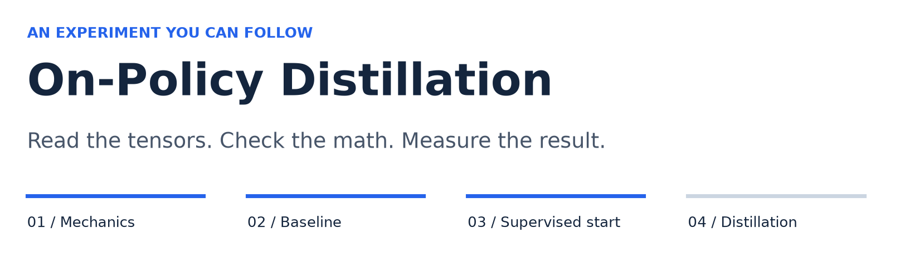

<p align="center">
  
</p>

<p align="center">
  <strong>A guided recreation of generalized on-policy knowledge distillation.</strong><br>
  PyTorch · Hugging Face · Qwen · GSM8K · SLURM
</p>

<p align="center">
  <a href="notebooks/01_reverse_kl_demo.ipynb">Mechanics</a> ·
  <a href="notebooks/02_baseline_evaluation.ipynb">Baseline</a> ·
  <a href="notebooks/03_sft_cold_start.ipynb">Supervised start</a> ·
  <a href="notebooks/04_on_policy_distillation.ipynb">Distillation</a> ·
  <a href="notebooks/05_qwen38_restart.ipynb">Model qualification</a>
</p>

## The research question

Can a small language model improve by learning from a stronger model's feedback
on **the responses it actually generates**?

The student samples a response. The frozen teacher scores possible next tokens
following those same response prefixes. Only the student receives gradients.
A matched supervised-KD control uses worked reference prefixes, helping isolate
the effect of on-policy data.

This is a small-scale adaptation of *On-policy Distillation of Language Models*
(Agarwal et al.). The project makes its mathematical objective, tensor alignment,
recovery behavior, evaluation rules, and observed failures inspectable.
[Read the paper](https://arxiv.org/html/2306.13649v3) · [Method-to-code review](PAPER_ALIGNMENT.md)

## Active experiment

| Role | Pinned model |
| :--- | :--- |
| Student | `Qwen/Qwen3.5-0.8B-Base` |
| Frozen teacher | `Qwen/Qwen3.8-27B` |
| Model profile | `qwen38` in the existing 03 and 04 notebooks |
| Intended runtime | Amarel with two allocated 40GB-or-larger GPUs, or a qualified 80GB GPU |

The shared tokenizers and output heads have been inspected using pinned files.
The training workflow is implemented. **New-model GPU qualification, training,
and any quality gain remain pending.** The older Qwen3 experiments have separate
[archived notebooks](notebooks/assets/historical_notebooks/README.md) and evidence.

## Notebook roadmap

| Notebook | What it establishes | Evidence |
| :--- | :--- | :--- |
| [01 · Distillation mechanics](notebooks/01_reverse_kl_demo.ipynb) | One trajectory, token probabilities, reverse KL, gradients, and one update | Historical A100 mechanics checks |
| [02 · Baseline evaluation](notebooks/02_baseline_evaluation.ipynb) | Frozen numeric checkers, formatting, extraction, and response-length analysis | Historical generation plus CPU replay |
| [03 · Supervised cold start](notebooks/03_sft_cold_start.ipynb) | Fresh profile-aware SFT and a verified checkpoint handoff | New-profile implementation with isolated CPU integration tests |
| [04 · Controlled on-policy distillation](notebooks/04_on_policy_distillation.ipynb) | Two learning-rate pilots, reference-prefix control, guarded continuation, and paired evaluation | New-profile implementation, historical failure audit, pending GPU study |
| [05 · Model qualification](notebooks/05_qwen38_restart.ipynb) | Tokenizer identity, causal scoring, synthetic memory/update/reload probes | Pinned-file inspection and tiny-model CPU checks, pending real GPU qualification |


## Run on Amarel

The **execution order for the new models is 05 → 03 → 04**. The conceptual learning
order remains 01 → 02 → 03 → 04. Each notebook starts independently of earlier
kernel variables.

1. Sync the complete project and activate `~/venvs/on-policy-qwen38`.
2. Connect VS Code to Jupyter running inside the SLURM GPU allocation.
3. In 05, run `inspect`, then `gpu_check`. Preserve its qualification report.
4. In 03, select `MODEL_PROFILE = "qwen38"` and `MODE = "train"`. Save the printed
   run directory. The checkpoint and report remain on Amarel.
5. In 04, select `MODE = "train"`, `RUN_STAGE = "pilot"`, and the completed
   `SFT_RUN_DIRECTORY`. Inspect both predeclared learning-rate pilots.
6. After a qualifying pilot, set `RUN_STAGE = "full"` and `RESUME_RUN_DIRECTORY`
   to that pilot parent folder. The selected optimizer and scheduler continue.

The fixed study uses 256 SFT examples, 64 validation questions, 1,024 additional KD
practice questions, and a reserved 256-question test subset. The teacher temperature
is 0.1 and student sampling temperature is 1. Both KD arms use the same EOS-aligned
forward KL. This ending-token grouping is a documented adaptation to the paper.

A six-hour allocation supports setup and execution with recovery across allocations.
Actual runtime depends on the GPUs, response lengths, and hybrid-attention kernels.
Progress files, per-question evaluation caches, and atomic snapshots survive client
disconnection. Keep the SLURM allocation inside tmux. Model cache uses scratch.
Checkpoints and reports use persistent project storage.

[Environment and connection instructions](notebooks/assets/05_qwen38_restart/RUN.md) ·
[Final run checklist](FINAL_RUN.md)

## What the recorded experiments showed

| Historical observation | Measured result |
| :--- | :--- |
| Original baseline | Strict matches 0/32, exploratory prose matches 17/32 |
| Supervised cold start | Format compliance 0/64 → 60/64, strict matches 0/64 → 32/64, prose matches 31/64 → 30/64 |
| EOS comparison starting student | 33/64 strict under the comparison's expanded ending policy |
| Raw-token pilot | Paused at update 18, with 1/64 strict matches and 53/64 greedy validation caps |
| Grouped-stop pilot | Reached update 32, with 23/64 strict matches and 4/64 greedy validation caps |
| First measured decline | Update 8 in both pilots, despite nearly unchanged reference NLL |

The downloaded EOS evidence passed checksum and checker replay across 400
trajectories. Grouping endings helped termination while arithmetic still regressed.
The revised safeguards replay a pause at update 8 in both histories. These old-model
results motivate the new controlled study. They provide no new-model improvement claim.
[Audited evidence](notebooks/assets/04_on_policy_distillation/recorded_eos_comparison/README.md)

## Reproduce CPU validation

Use a separate user environment with Python 3.11. No global installation is needed.

```bash
uv venv --python 3.11 .venv-qa
uv pip install --python .venv-qa/bin/python torch==2.10.0 \
  --index-url https://download.pytorch.org/whl/cpu
uv pip install --python .venv-qa/bin/python \
  -r requirements-qwen38.txt -r requirements-qa.txt
.venv-qa/bin/python scripts/check_cpu.py
```

This command runs the full unit suite, static notebook checks, clean-kernel 02
replay, both-profile 03/04 inspection, and 05 inspection. It downloads pinned data
and tokenizer/configuration files. It loads no pretrained model weights. Synthetic
training fixtures exercise the actual shared runner, including hybrid attention,
optimizer recovery, checkpoint reload, and export. Reports live in
`results/cpu_release_qa/`. [Validation record](VALIDATION.md)

## Interpreting the final result

Report strict numeric matching, formatting, exploratory prose matching, stopping,
and paired uncertainty together. A lower KL value alone cannot establish better
answers. The small, one-seed test subset limits generalization. Include regressions
and preserve raw responses so every metric can be replayed.

The goal is a clear, reproducible experiment that can demonstrate an observed
improvement and explain its limits. The final conclusion follows the measured run.
