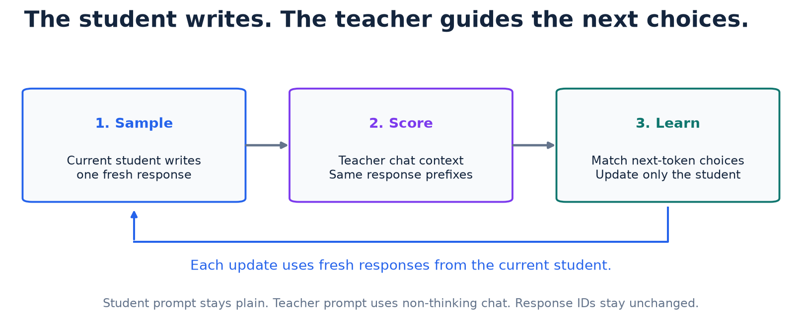

<p align="center">
  
</p>

<p align="center">
  <strong>A guided language-model distillation project, from one trajectory to a controlled training experiment.</strong><br>
  PyTorch · Hugging Face · Qwen3 · Google Colab
</p>

<p align="center">
  <a href="notebooks/01_reverse_kl_demo.ipynb">Explore the mechanics</a> ·
  <a href="notebooks/02_baseline_evaluation.ipynb">Inspect the baseline</a> ·
  <a href="notebooks/03_sft_cold_start.ipynb">Build the supervised start</a> ·
  <a href="notebooks/04_on_policy_distillation.ipynb">Run on-policy distillation</a> ·
  <a href="https://arxiv.org/abs/2306.13649">Read the GKD paper</a>
</p>

## The question

How do we teach a small language model using feedback on **the responses it actually writes**?

In on-policy distillation, the student generates a response. A frozen teacher
scores possible next tokens after those exact response prefixes, using its own
question context. The student then learns from
that feedback. This project makes the boundaries visible: token alignment,
probabilities, loss, gradients, evaluation, and the evidence behind each result.

This is an educational adaptation of **Generalized Knowledge Distillation (GKD)**,
not a reproduction of its models, training scale, or published benchmark scores.
The aim is an inspectable experiment with explanations an early-career ML engineer
can follow, rather than a claim of state-of-the-art performance.

| Student | Teacher | Working environment |
| :--- | :--- | :--- |
| `Qwen/Qwen3-0.6B-Base` | `Qwen/Qwen3-32B` | Colab A100 80GB for 01/04; 03 trains only the small student |

The teacher is loaded in 01 and in 04's CUDA experiment. **Notebook 03 only trains
the student** using existing GSM8K reference solutions. 04 reads its saved checkpoint
and report, not an earlier notebook's live kernel variables.

## Follow the experiment

| Notebook | What you learn | Evidence and current status |
| :--- | :--- | :--- |
| [**01 · One student trajectory**](notebooks/01_reverse_kl_demo.ipynb) | Token probabilities, tokenizer compatibility, frozen-teacher scoring, reverse KL, and one student update | Saved A100 outputs verify the seven mechanics checkpoints; no quality improvement established |
| [**02 · Baseline evaluation**](notebooks/02_baseline_evaluation.ipynb) | Fixed questions, greedy generation, answer extraction, metrics, and failure analysis | Completed Colab generation outputs plus separately validated CPU replay |
| [**03 · Supervised cold start**](notebooks/03_sft_cold_start.ipynb) | Response-only SFT, data isolation, gradient accumulation, paired validation, checkpoint export | Completed A100 SFT; latest report and checkpoint integrity verified; mixed reasoning results |
| [**04 · On-policy distillation**](notebooks/04_on_policy_distillation.ipynb) | Full-vocabulary forward KL, fresh student responses, continued-SFT control, paired evaluation, restart/export | Interrupted GPU run and teacher-context probe archived; corrected 32-update pilot ready for Colab qualification |

Each notebook introduces the idea, walks through small examples and tensor shapes,
checks assumptions, and ends with a plain-language recap. No notebook depends on
an earlier notebook's live kernel state. 04 reads 03's verified saved artifacts.

<p align="center">
  <a href="notebooks/04_on_policy_distillation.ipynb">
    
  </a>
</p>

## What the evidence actually says

| Observation | Result | Interpretation |
| :--- | :--- | :--- |
| 01: reverse KL on the saved response | About **0.1592 → 3.9137 nats** after one update | The update mechanics ran; this step increased disagreement |
| 02: strict-format numeric matches | **0 / 32** | None of the original responses used the requested `####` marker |
| 02: exploratory prose numeric matches | **17 / 32 (53.125%)** | A broader, post-hoc extractor found matching numbers; this is not a training gain |
| 02: prose-parsed responses / token-limit stops | **28 / 32** parsed; **2 / 32** budget stops | Format, arithmetic, extraction, and stopping failures are kept visible |
| 03: paired validation after 256 reference examples | Format **0/64 → 60/64**; prose matches **31/64 → 30/64**; NLL **0.776 → 0.667** | Latest verified A100 run; strong format learning, mixed reasoning, and visible regressions |
| 04: interrupted raw-prompt run | **232/232 capped responses** during updates 24–52; validation NLL **0.667 → 0.969** | A real failure, despite decreasing fixed-prefix KL |
| 04: teacher context probe | Boundary stopping mass **3.93 × 10⁻⁸ → 0.530** | One saved response, raw versus non-thinking chat; arithmetic quality remains a separate question |
| 04: corrected full experiment | **Pending Colab qualification** | Local checks verify implementation; improved task performance remains unmeasured |

The two 02 scores use the **same model responses**, with all questions retained
in the denominator. Numeric agreement does not certify reasoning or units. The
prose checker was developed after inspecting that run, so its score is exploratory.
A 32-question sample is not an official GSM8K leaderboard evaluation.

<details>
<summary><strong>Why zero strict accuracy does not mean zero arithmetic ability</strong></summary>

The prompt requests a final line such as `#### 1430`. A response ending with
`The final answer is $1430.` does not satisfy that format, even when the number
is right. The original strict rule is preserved; the prose rule is reported
separately. Later training must be evaluated under frozen rules, not a checker
rewritten to make its answers look better.

</details>

## Start here

### In Colab or a VS Code Colab kernel

1. Open [02](notebooks/02_baseline_evaluation.ipynb) to inspect evaluation, or
   [03](notebooks/03_sft_cold_start.ipynb) to prepare the supervised starting point.
   With its saved checkpoint and report, continue to [04](notebooks/04_on_policy_distillation.ipynb).
2. Make sure the **complete project** is available on the runtime. The notebook
   can clone public `dev` into `/content`; an existing runtime checkout must be
   updated separately from local VS Code files.
3. Choose the mode, then run from the top. If setup installs dependencies and
   requests a kernel restart, restart and run from the top again.
4. Download the results and save the executed notebook before disconnecting.
   Colab storage is temporary; no Google Drive is required.

| Notebook | CPU path | CUDA path |
| :--- | :--- | :--- |
| 02 | `MODE = "replay"`: analyze the checksummed original responses | `MODE = "generate"`: generate a fresh baseline |
| 03 | `MODE = "inspect"`: real tokenizer/data and target-mask checks | `MODE = "train"`: small full-parameter SFT run, evaluation, and export |
| 04 | `MODE = "inspect"`: data isolation, shared tokenizer, masks, illustrative KL | `MODE = "train"`, `RUN_STAGE = "pilot"`: A100 80GB; 32-update qualification before full continuation |

For 03, defaults are **256 practice / 64 validation examples**, one epoch,
1,024-token complete sequences, microbatch size 1, and accumulation over eight
microbatches. The notebook explains the response-only loss and makes optimizer
steps visible. Reserved test questions are excluded from training and tuning.
Checkpoint weights are large. Packaging, checksum verification, and file transfer
are separate steps; automatic multi-gigabyte browser downloads are avoided.

### Notebook 04: the checkpoint handoff

Keep both **03's `report.zip` and `checkpoint.zip`**. The report contains split IDs,
metrics, and weight fingerprints, but no weights. If the original Colab runtime
still has its `results/sft_cold_start_.../checkpoint` and `report` folders, 04 can
find them. Otherwise upload both ZIPs and set `SFT_REPORT_PATH` and
`SFT_CHECKPOINT_PATH` to their paths on the remote runtime.

04 defaults to inspection. Its fixed recipe uses **1,024 new practice questions**,
**128 updates per arm**, a **256-token sampled-response budget**, and a
**256-question primary test** excluding the previously inspected 32 questions.
The teacher uses its pinned non-thinking chat context; the student retains its 03
prompt and exact sampled response IDs. Teacher targets use temperature 0.1;
student sampling uses temperature 1 without
top-k/top-p filtering. No LoRA or quantization is used. The teacher revision is
pinned and its full output vocabulary is retained.

All three 04 models are evaluated again under identical greedy settings, including
both models' recognized end-token IDs. This differs from 02/03's historical
stopping rule. Those old scores remain context, not a paired 04 baseline.

### Notebook 04 qualification and continuation

1. Upload the verified 03 report and checkpoint ZIPs. Select the A100 80GB kernel,
   set `MODE = "train"` and leave `RUN_STAGE = "pilot"`.
2. Run in order. Inspect the starting student, supervised control, teacher
   validation results, separate prompt offsets, and fresh sampled responses.
3. The distillation pilot pauses after 32 updates. Snapshots and validation checks
   occur every eight pilot updates. Review the pilot table and example responses.
4. Download the small pilot report. For continuation on a replacement runtime,
   also retain the run folder with its optimizer-state snapshots and control
   checkpoint. The report alone contains no model or optimizer weights.
5. Restart the notebook kernel to release loaded models. Set `RUN_STAGE = "full"`
   and `RESUME_RUN_DIRECTORY` to the pilot's run folder, then run from the top.
   The remaining updates retain the same scheduler horizon, question order, and RNG.
6. Evaluate the fixed primary test only after full training completes. Download
   the final report and checkpoints, then save the executed notebook.

At least 24 capped responses in the latest 32 triggers a recovery pause. A
reference-NLL increase above 25% triggers a review warning. These are documented
engineering alarms. The pilot does not establish statistical improvement.
A health-paused run needs investigation before a revised recipe starts again
from the verified 03 checkpoint.

See the [failure analysis](notebooks/assets/04_on_policy_distillation/INVESTIGATION.md)
and [next-run checklist](notebooks/assets/04_on_policy_distillation/NEXT_RUN.md).

### Local validation

Use an isolated Python environment. The existing analysis lock is validated on
Python 3.14; its pinned wheels require a compatible Python 3.12+ environment.

```bash
uv venv
uv pip install -r requirements-notebook.txt
.venv/bin/python scripts/validate_notebook02.py
```

For 03 inspection and the tiny-model tests, also install the pinned Hugging Face
libraries and an appropriate PyTorch build. On a CPU-only machine:

```bash
uv pip install torch==2.10.0 --index-url https://download.pytorch.org/whl/cpu
uv pip install -r requirements-opd.txt
.venv/bin/python -m unittest discover -s tests -v
.venv/bin/python scripts/validate_notebook03.py
.venv/bin/python scripts/validate_notebook04.py
.venv/bin/python -m ruff check src scripts tests notebooks/*.ipynb
.venv/bin/python -m ruff format --check src scripts tests notebooks/*.ipynb
```

**Do not install the CPU PyTorch build into Colab.** Its notebook setup preserves
Colab's existing PyTorch/CUDA stack. Local CPU tests do not establish that the
0.6B student trained successfully on a GPU.

Validators write separate executed QA copies and HTML previews under ignored
`results/`. They preserve the source notebooks unless their explicit output-update
flag is requested. 03/04 inspection needs public pinned tokenizer/data downloads
on the first run, but no model weights. 04 also reads the teacher's pinned tokenizer/configuration.

## Under the hood

```text
notebooks/       Guided experiments, diagrams, and recorded evidence
src/             Evaluation, generation, token alignment, SFT, and exact KL helpers
configs/         Student and teacher model choices
scripts/         Notebook QA, source verification, and asset generation
tests/           Extraction, alignment, gradient, checkpoint, and archive checks
results/         Local run artifacts and previews, ignored by Git
```

- **Inspect the math:** [response-only SFT](src/sft.py),
  [full-vocabulary forward KL](src/opd_loss.py), [causal alignment](src/logprobs.py),
  [reference-blind extraction](src/evaluation.py), and
  [baseline generation and evidence validation](src/baseline.py).
- **Audit the evidence:** [02 validation](notebooks/assets/02_baseline_evaluation/VALIDATION.md),
  [03 validation](notebooks/assets/03_sft_cold_start/VALIDATION.md),
  [04 validation](notebooks/assets/04_on_policy_distillation/VALIDATION.md), and
  [the immutable original A100 run](notebooks/assets/02_baseline_evaluation/recorded_run).
- **Reuse the result:** 03 saves a Hugging Face-compatible student checkpoint for
  04, plus separate training/evaluation evidence with checksums. Weights and
  credentials are never committed to this repository.

Rescore a downloaded 02 baseline without a GPU:

```bash
python -m src.evaluation /path/to/baseline --output-directory results/prose_review
```

## Research context and limitations

GKD addresses the mismatch between fixed training responses and the prefixes a
student generates itself. The original arithmetic experiments began from
supervised-fine-tuned models. Our 03 reference-solution warm start is a smaller,
explicitly different adaptation. It does not itself perform distillation.

The project establishes working mechanics, an inspectable baseline, a completed
small supervised cold start, and an implemented controlled distillation experiment.
The latest 03 run has four validation token-limit stops and a displayed
correct-to-incorrect answer regression. Its saved historical-test score is 18/32
strict matches. An earlier 03 run had different observed scores and remains in
Git history. These small experiments do not establish broad reasoning improvement.

The first 04 run degraded while matching teacher probabilities under a raw prompt.
A one-response context probe supported changing the teacher interface. The
corrected experiment remains an educational GKD adaptation whose GPU training
and resulting performance need qualification. All original response IDs are
preserved, while teacher and student question wrappers differ explicitly.

The arms differ in objectives, response lengths, and compute cost. An off-policy
KD arm would help isolate the effect of student-generated prefixes. Multi-seed
training and a larger untouched evaluation would strengthen later conclusions.

- [On-Policy Distillation of Language Models: Learning from Self-Generated Mistakes](https://arxiv.org/abs/2306.13649)
- [GSM8K dataset and reference solutions](https://huggingface.co/datasets/openai/gsm8k), MIT licensed;
  [license copy](notebooks/assets/02_baseline_evaluation/GSM8K_LICENSE.txt)
- [Qwen3 student](https://huggingface.co/Qwen/Qwen3-0.6B-Base) and
  [Qwen3 teacher](https://huggingface.co/Qwen/Qwen3-32B)

<sub>Built to make the experiment understandable, the assumptions visible, and the results reviewable.</sub>
