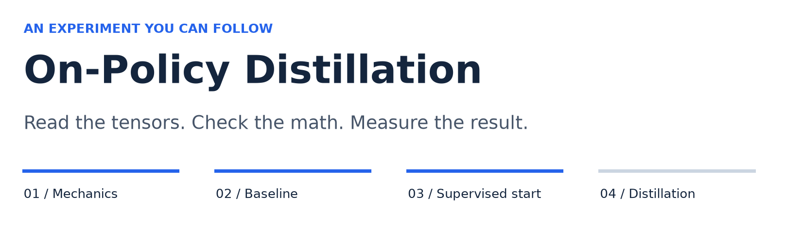

<p align="center">
  
</p>

<p align="center">
  <strong>A guided language-model distillation project, from one trajectory to a supervised starting point.</strong><br>
  PyTorch · Hugging Face · Qwen3 · Google Colab
</p>

<p align="center">
  <a href="notebooks/01_reverse_kl_demo.ipynb">Explore the mechanics</a> ·
  <a href="notebooks/02_baseline_evaluation.ipynb">Inspect the baseline</a> ·
  <a href="notebooks/03_sft_cold_start.ipynb">Build the supervised start</a> ·
  <a href="https://arxiv.org/abs/2306.13649">Read the GKD paper</a>
</p>

## The question

How do we teach a small language model using feedback on **the responses it actually writes**?

In on-policy distillation, the student generates a response. A frozen teacher
scores those same tokens after the same prefixes. The student then learns from
that feedback. This project makes the boundaries visible: token alignment,
probabilities, loss, gradients, evaluation, and the evidence behind each result.

This is an educational adaptation of **Generalized Knowledge Distillation (GKD)**,
not a reproduction of its models, training scale, or published benchmark scores.
The aim is an inspectable experiment with explanations an early-career ML engineer
can follow, rather than a claim of state-of-the-art performance.

| Student | Teacher | Working environment |
| :--- | :--- | :--- |
| `Qwen/Qwen3-0.6B-Base` | `Qwen/Qwen3-32B` | Colab A100 80GB for the recorded mechanics run; 03 targets A100/L4 |

The teacher is loaded in 01. **Notebook 03 only trains the student** using existing
GSM8K reference solutions. It does not load the 32B teacher.

## Follow the experiment

| Notebook | What you learn | Evidence and current status |
| :--- | :--- | :--- |
| [**01 · One student trajectory**](notebooks/01_reverse_kl_demo.ipynb) | Token probabilities, tokenizer compatibility, frozen-teacher scoring, reverse KL, and one student update | Saved A100 outputs verify the seven mechanics checkpoints; no quality improvement established |
| [**02 · Baseline evaluation**](notebooks/02_baseline_evaluation.ipynb) | Fixed questions, greedy generation, answer extraction, metrics, and failure analysis | Completed Colab generation outputs plus separately validated CPU replay |
| [**03 · Supervised cold start**](notebooks/03_sft_cold_start.ipynb) | Response-only SFT, data isolation, gradient accumulation, paired validation, checkpoint export | Completed A100 SFT outputs; format learning is strong, reasoning results are mixed; stronger tokenizer reload checks added afterward |
| [**04 · On-policy distillation**](notebooks/04_on_policy_distillation.ipynb) | Fresh student responses and frozen-teacher feedback after the cold start | Planned; scaffold only |

Each notebook introduces the idea, walks through small examples and tensor shapes,
checks assumptions, and ends with a plain-language recap. Notebooks 02 and 03
start independently; they do not require an earlier notebook's live kernel state.

## What the evidence actually says

| Observation | Result | Interpretation |
| :--- | :--- | :--- |
| 01: reverse KL on the saved response | About **0.1592 → 3.9137 nats** after one update | The update mechanics ran; this step increased disagreement |
| 02: strict-format numeric matches | **0 / 32** | None of the original responses used the requested `####` marker |
| 02: exploratory prose numeric matches | **17 / 32 (53.125%)** | A broader, post-hoc extractor found matching numbers; this is not a training gain |
| 02: prose-parsed responses / token-limit stops | **28 / 32** parsed; **2 / 32** budget stops | Format, arithmetic, extraction, and stopping failures are kept visible |
| 03: paired validation after 256 reference examples | Format **0/64 → 59/64**; prose matches **31/64 → 35/64**; NLL **0.776 → 0.667** | A real A100 run; strong format learning, modest numeric gain, and visible regressions |

The two 02 scores use the **same model responses**, with all questions retained
in the denominator. Numeric agreement does not certify reasoning or units. The
prose checker was developed after inspecting that run, so its score is exploratory.
A 32-question sample is not an official GSM8K leaderboard evaluation.

<details>
<summary><strong>Why zero strict accuracy does not mean zero arithmetic ability</strong></summary>

The prompt requests a final line such as `#### 1430`. A response ending with
`The final answer is $1430.` does not satisfy that format, even when the number
is right. The original strict rule is preserved; the prose rule is reported
separately. Later training must be evaluated under frozen rules, not a checker
rewritten to make its answers look better.

</details>

## Start here

### In Colab or a VS Code Colab kernel

1. Open [02](notebooks/02_baseline_evaluation.ipynb) to inspect evaluation, or
   [03](notebooks/03_sft_cold_start.ipynb) to prepare the supervised starting point.
2. Make sure the **complete project** is available on the runtime. The notebook
   can clone public `dev` into `/content`; an existing runtime checkout must be
   updated separately from local VS Code files.
3. Choose the mode, then run from the top. If setup installs dependencies and
   requests a kernel restart, restart and run from the top again.
4. Download the results and save the executed notebook before disconnecting.
   Colab storage is temporary; no Google Drive is required.

| Notebook | CPU path | CUDA path |
| :--- | :--- | :--- |
| 02 | `MODE = "replay"`: analyze the checksummed original responses | `MODE = "generate"`: generate a fresh baseline |
| 03 | `MODE = "inspect"`: real tokenizer/data and target-mask checks | `MODE = "train"`: small full-parameter SFT run, evaluation, and export |

For 03, defaults are **256 practice / 64 validation examples**, one epoch,
1,024-token complete sequences, microbatch size 1, and accumulation over eight
microbatches. The notebook explains the response-only loss and makes optimizer
steps visible. Reserved test questions are excluded from training and tuning.
Checkpoint weights are large, so report and weight downloads have separate switches.

### Local validation

Use an isolated Python environment. The existing analysis lock is validated on
Python 3.14; its pinned wheels require a compatible Python 3.12+ environment.

```bash
uv venv
uv pip install -r requirements-notebook.txt
.venv/bin/python scripts/validate_notebook02.py
```

For 03 inspection and the tiny-model tests, also install the pinned Hugging Face
libraries and an appropriate PyTorch build. On a CPU-only machine:

```bash
uv pip install torch==2.10.0 --index-url https://download.pytorch.org/whl/cpu
uv pip install -r requirements-sft.txt
.venv/bin/python -m unittest discover -s tests -v
.venv/bin/python scripts/validate_notebook03.py
```

**Do not install the CPU PyTorch build into Colab.** Its notebook setup preserves
Colab's existing PyTorch/CUDA stack. Local CPU tests do not establish that the
0.6B student trained successfully on a GPU.

Validators write separate executed QA copies and HTML previews under ignored
`results/`. They preserve the source notebooks unless their explicit output-update
flag is requested. 03 inspection needs the public pinned tokenizer/data download
on its first run, but no student weights.

## Under the hood

```text
notebooks/       Guided experiments, diagrams, and recorded evidence
src/             Evaluation, baseline inference, and supervised-training helpers
configs/         Student and teacher model choices
scripts/         Notebook QA, source verification, and asset generation
tests/           Extraction, alignment, gradient, checkpoint, and archive checks
results/         Local run artifacts and previews, ignored by Git
```

- **Inspect the math:** [response-only SFT](src/sft.py),
  [reference-blind extraction](src/evaluation.py), and
  [baseline generation and evidence validation](src/baseline.py).
- **Audit the evidence:** [02 validation](notebooks/assets/02_baseline_evaluation/VALIDATION.md),
  [03 validation](notebooks/assets/03_sft_cold_start/VALIDATION.md), and
  [the immutable original A100 run](notebooks/assets/02_baseline_evaluation/recorded_run).
- **Reuse the result:** 03 saves a Hugging Face-compatible student checkpoint for
  04, plus separate training/evaluation evidence with checksums. Weights and
  credentials are never committed to this repository.

Rescore a downloaded 02 baseline without a GPU:

```bash
python -m src.evaluation /path/to/baseline --output-directory results/prose_review
```

## Research context and limitations

GKD addresses the mismatch between fixed training responses and the prefixes a
student generates itself. The original arithmetic experiments began from
supervised-fine-tuned models. Our 03 reference-solution warm start is a smaller,
explicitly different adaptation. It does not itself perform distillation.

The project establishes working mechanics, an inspectable baseline, and a completed small supervised cold start.
It does **not** establish a post-distillation quality gain. The 03 run also produced five validation token-limit stops and a displayed correct-to-incorrect answer regression. Its saved test score is 14/32 strict matches; broad reasoning improvement is not established. The teacher remains
fixed in the mechanics demonstration; no large-scale training or multi-seed
benchmark comparison has been completed. Stronger claims require untouched test
data, frozen metrics, repeated runs, and actual trained-model evidence.

- [On-Policy Distillation of Language Models: Learning from Self-Generated Mistakes](https://arxiv.org/abs/2306.13649)
- [GSM8K dataset and reference solutions](https://huggingface.co/datasets/openai/gsm8k), MIT licensed;
  [license copy](notebooks/assets/02_baseline_evaluation/GSM8K_LICENSE.txt)
- [Qwen3 student](https://huggingface.co/Qwen/Qwen3-0.6B-Base) and
  [Qwen3 teacher](https://huggingface.co/Qwen/Qwen3-32B)

<sub>Built to make the experiment understandable, the assumptions visible, and the results reviewable.</sub>
