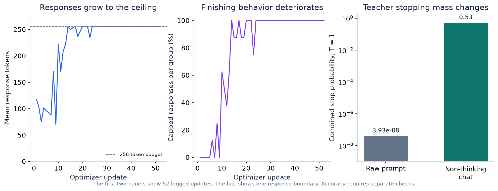
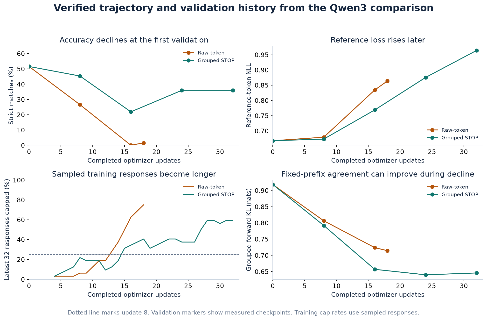

# Stopping-behavior investigation

The earlier raw-context failure and follow-up Amarel pilot are separate records.
The context probe showed higher stopping probability under non-thinking chat.
The follow-up pilot still deteriorated in stopping. The completed EOS comparison reduced stopping failures while answer quality
continued to deteriorate. Its downloaded records are now audited locally.

## Earlier raw-context failure

The downloaded A100 records contain 416 student responses across 52 complete
optimizer updates. Logs, response lengths, EOS/cap flags, and recorded update
counts agree. The saved notebook separately contains console output through
update 61. Detailed trajectory claims below use the 52-update download.

All 232 responses from updates 24 through 52 reached 256 tokens without EOS.
Actual text includes repeated `Okay.`, restarting a question after `####`, and
extended self-questioning. Validation reference-token NLL rose from 0.666930 to
0.969434 at update 32 while fixed-prefix forward KL reached 0.596862. These are
different objectives; lower KL did not establish improved answers.



*The first two panels use complete training records. The right panel uses one
response boundary. Its logarithmic axis makes the small raw-context stopping
probability visible.*

## User-run teacher probe

The frozen teacher scored the same early response under raw and non-thinking
chat contexts. No weights were updated during this probe.

| Boundary measurement | Raw question context | Non-thinking chat context |
| :--- | ---: | ---: |
| Combined stop probability at temperature 1 | 3.932740 × 10⁻⁸ | 0.5299051 |
| Combined stop target mass at temperature 0.1 | Printed as 0.0000 | Printed as 0.7773 |
| Leading next token at the response boundary | `.` | `<\|im_end\|>` |
| Leading token before the first response token | `Okay` | `Let` |

These are rounded printed values. A displayed zero can reflect rounding or FP32
underflow. The probe utility now also reports combined stopping mass in log space.
The observed final token was `<|endoftext|>`. Its individual teacher probability
remained low in both contexts; chat formatting transferred ending mass to the
teacher's `<|im_end|>` token. Both IDs remain recognized generation stops.

The sampled answer ended in `#### 360` for a question whose expected answer is 30.
The probe therefore measures context and termination preferences, not arithmetic
correctness. Its contrast supports the conditioning diagnosis on this prefix.
The later Amarel run provides separate training evidence below.

## Correction and experimental boundary

The teacher now receives the pinned Qwen non-thinking chat prefix for the original
question prompt. The student retains its 03 question format. The exact sampled
response IDs are appended to each context directly. Each model's own prompt
length determines its `P - 1` response-logit slice. Both aligned response-logit
tensors have shape `[1, response_length, vocabulary_size]`.

This is an explicit GKD adaptation with model-specific question contexts and
identical preceding response IDs. It changes the teacher context without
retokenizing student responses. The full vocabulary and temperature 0.1 remain
part of the objective. Old raw-context snapshots have a different signature.

The follow-up Amarel run started from 03's verified weights and qualified teacher
behavior on 64 validation questions. Its cap-rate guard paused training at update
22. The next controlled comparison starts two fresh 32-update pilots from 03.
Primary-test evaluation stays gated until a fixed full run completes.
See [the next-run checklist](NEXT_RUN.md).

## Reproduction and preservation

The [archived manifest](recorded_failure/manifest.json) links the original failure
and successful GPU probe to their exact source snapshots and fingerprints.
Archived source is evidence and is never imported by the notebooks.

```bash
python scripts/audit_opd_run.py notebooks/assets/04_on_policy_distillation/recorded_failure
```

The test suite checks causal offsets, frozen-teacher gradients, exact KL,
EOS handling, staging, and restart behavior using tiny random models. These
checks cannot establish real-model stopping behavior or task improvements. The
same distinction applies to the recovered real student's short local CPU forward
check. The completed comparison is documented below. Revised safety behavior awaits
its own GPU execution.

## Primary references

- [Pinned Qwen3-32B usage and non-thinking mode](https://huggingface.co/Qwen/Qwen3-32B/blob/9216db5781bf21249d130ec9da846c4624c16137/README.md)
- [Pinned Qwen teacher chat template](https://huggingface.co/Qwen/Qwen3-32B/blob/9216db5781bf21249d130ec9da846c4624c16137/tokenizer_config.json)
- [GKD Algorithm 1 and GSM8K Appendix A.4](https://arxiv.org/html/2306.13649v3)

## Follow-up Amarel pilot and controlled EOS hypothesis

The November 8 run produced 176 consistent responses across 22 updates. Its health
guard triggered when 24 of the final 32 responses reached the 256-token cap.
The saved notebook shows that training paused at this boundary, then evaluated
48/64 questions before the allocation expired. The checkpoint is a health-pause
boundary. Extending the SLURM limit alone would not address the recorded drift.
[Recorded Amarel audit and snapshot](recorded_amarel_pilot/README.md)

The teacher's non-thinking chat validation reached 52/64 strict matches. The
starting student reached 32/64 and the continued-SFT control reached 40/64.
The teacher therefore supplies useful task competence under this question format,
while the distillation pilot still exhibits repetition and stopping deterioration.
Reference NLL rose from 0.666930 to 0.819338 by update 16 as fixed-prefix KL fell.
This supports diagnosing the supervision beyond a scalar training loss.

### Why examine ending-token probabilities?

The student and teacher accept the same two stopping IDs during generation.
Earlier probes nevertheless showed different learned preferences between
`endoftext` and `im_end`. The loss compares these surface tokens separately.
A small CPU example shows that raw forward KL can exert a nonzero ending-token
update even when both distributions assign the same total probability to stopping.
This is an illustrative mathematical check, not a real-model causal result.

A Reddit discussion describes endless or malformed continuations after Qwen3 Base
fine-tuning. Its suggestions include response-only training and EOS/format checks.
Those are leads; our source already masks padding by position and preserves real
EOS targets. A matching base-to-instruct distillation issue uses reverse KL and
recommends an instruction-format SFT cold start. We retain the verified 03 weights
and test the loss interpretation independently before changing that cold start.
[Reddit discussion](https://www.reddit.com/r/LocalLLaMA/comments/1kfuv3v/anybody_have_luck_finetuning_qwen3_base_models/),
[ms-swift issue](https://github.com/modelscope/ms-swift/issues/9526)

The EOS-alignment research studies sampled-token OPD. Our full-vocabulary forward
KL already supplies gradients to all vocabulary columns, so its sampling-coverage
explanation cannot simply be transferred. We test a coarsened forward KL that
compares the total ending probability of each model as one STOP class, preserving
all ordinary vocabulary contributions and original response IDs. The two losses
are reported side by side on frozen prefixes. EOS equivalence is restricted to
this single-turn protocol. Tool handoffs or multi-turn endings would need a new
semantic analysis. The completed comparison below measures this adaptation on the historical models.
[EOS-alignment paper](https://arxiv.org/html/2609.20511v1)

### Controlled evidence before changing other settings

Both new pilots begin at the same 03 checkpoint, with seed 42, identical question
order, teacher temperature 0.1, peak learning rate 5e-6, eight-response accumulation,
and the original 128-update schedule. The teacher is frozen and shared across
sequential arms. Each arm has its own optimizer, RNG, signature, and recovery folder.
Only EOS interpretation differs. The source GSM8K recipe specifies teacher
temperature 0.1; a later temperature or learning-rate change requires a separate
comparison. The 256-question primary test stays reserved.
[GKD Appendix A.4](https://arxiv.org/html/2306.13649v3#S4.SS3)

Diagnostics use 03, update 16, and update 22 on identical recorded prefixes.
They inspect individual/combined ending mass at ordinary and target temperature,
and gradients with respect to detached logit copies. They include natural EOS,
first final-answer lines, and post-cap continuation boundaries without inventing
an observed EOS token. The full raw records and source snapshot inventories are
still needed on Amarel for these forwards. The local audit alone cannot establish
the cause. Timeouts, memory failures, and unhealthy learning are recorded separately.


## Completed comparison and the first visible failure

The [downloaded evidence audit](recorded_eos_comparison/README.md) verifies 69
collected files and 400 trajectories. Both arms started at 33/64 strict matches
and reference NLL 0.667651. Their initial rollout groups were identical.

| Boundary | Raw-token strict matches | Grouped-stop strict matches | Raw NLL | Grouped NLL |
| :--- | ---: | ---: | ---: | ---: |
| Start | 33/64 | 33/64 | 0.667651 | 0.667651 |
| Update 8 | 17/64 | 29/64 | 0.679250 | 0.673062 |
| Update 16 | 0/64 | 14/64 | 0.834041 | 0.768628 |
| Final | 1/64 at 18 | 23/64 at 32 | 0.863818 | 0.963980 |



*Validation markers use the saved GPU histories. The dotted line marks the first
measured decline. Training cap rates use the latest 32 sampled responses.*

Grouping EOS aliases helped termination. At the final boundaries, greedy
validation caps were 53/64 for raw-token and 4/64 for grouped-stop. Sampled
training still capped 24/32 and 19/32 respectively. The two decoding policies and
token budgets differ, so both measurements remain visible.

The earliest demonstrated quality problem is at update 8. In the grouped arm,
nine previously correct validation answers became incorrect and five became
correct. Question `gsm8k/train/139` changes a correct 24 to 25 after inventing an
extra flight. Question `gsm8k/train/1849` changes a correct 40 to 20 while keeping
a valid final-answer marker. These examples demonstrate arithmetic regression.
Reference NLL alone would have missed this first measured decline.

Every recorded update had a finite pre-clipping gradient norm above 1.0. The first
update used zero learning rate during scheduler warmup, and peak rate 5e-6 was
reached at update 14. The records establish when deterioration became visible.
They leave the causal contributions of sharpening, update size, and capacity open.
A larger model pair requires a fresh baseline and supervised checkpoint.

## Revised safeguards

The new policy pauses when strict accuracy drops more than five percentage points
from baseline, reference NLL exceeds 110% of baseline, or more than eight of the
latest 32 sampled responses hit the cap. Validation remains every eight pilot
updates. Replaying these limits over the saved histories requests a pause at
update 8 for both arms. This replay measures guard decisions on old records.
Real-model behavior under the revised guard still requires a new GPU run.

A checksummed boundary is saved before validation. Derived metrics are stored
separately and restored before another update is allowed. The last acceptable
checkpoint is protected alongside the latest two snapshots. A quality-paused run
can finish evaluation with its saved weights. Continuing optimization requires a
new reviewed experiment. Reports package automatically at pause boundaries.
Deadline checks run before each trajectory, with a ten-minute SLURM reserve.
Mid-group deadline recovery restores RNG to the previous complete update.

New frozen probes also record entropy and separate ordinary-token, raw-EOS, and
grouped-EOS KL contributions. The old archive predates these extra fields. Fresh
model forwards are required to populate them.
