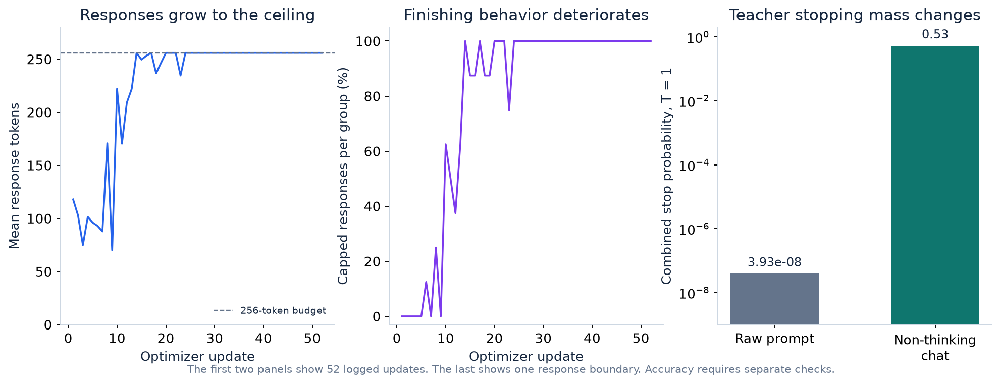

# Teacher-context investigation

## Observed failure

The downloaded A100 records contain 416 student responses across 52 complete
optimizer updates. Logs, response lengths, EOS/cap flags, and recorded update
counts agree. The saved notebook separately contains console output through
update 61. Detailed trajectory claims below use the 52-update download.

All 232 responses from updates 24 through 52 reached 256 tokens without EOS.
Actual text includes repeated `Okay.`, restarting a question after `####`, and
extended self-questioning. Validation reference-token NLL rose from 0.666930 to
0.969434 at update 32 while fixed-prefix forward KL reached 0.596862. These are
different objectives; lower KL did not establish improved answers.



*The first two panels use complete training records. The right panel uses one
response boundary. Its logarithmic axis makes the small raw-context stopping
probability visible.*

## User-run teacher probe

The frozen teacher scored the same early response under raw and non-thinking
chat contexts. No weights were updated during this probe.

| Boundary measurement | Raw question context | Non-thinking chat context |
| :--- | ---: | ---: |
| Combined stop probability at temperature 1 | 3.932740 × 10⁻⁸ | 0.5299051 |
| Combined stop target mass at temperature 0.1 | Printed as 0.0000 | Printed as 0.7773 |
| Leading next token at the response boundary | `.` | `<\|im_end\|>` |
| Leading token before the first response token | `Okay` | `Let` |

These are rounded printed values. A displayed zero can reflect rounding or FP32
underflow. The probe utility now also reports combined stopping mass in log space.
The observed final token was `<|endoftext|>`. Its individual teacher probability
remained low in both contexts; chat formatting transferred ending mass to the
teacher's `<|im_end|>` token. Both IDs remain recognized generation stops.

The sampled answer ended in `#### 360` for a question whose expected answer is 30.
The probe therefore measures context and termination preferences, not arithmetic
correctness. Its contrast supports the conditioning diagnosis on this prefix.
A corrected training run is still required to establish broader behavior.

## Correction and experimental boundary

The teacher now receives the pinned Qwen non-thinking chat prefix for the original
question prompt. The student retains its 03 question format. The exact sampled
response IDs are appended to each context directly. Each model's own prompt
length determines its `P - 1` response-logit slice. Both aligned response-logit
tensors have shape `[1, response_length, vocabulary_size]`.

This is an explicit GKD adaptation with model-specific question contexts and
identical preceding response IDs. It changes the teacher context without
retokenizing student responses. The full vocabulary and temperature 0.1 remain
part of the objective. Old raw-context snapshots have a different signature.

The next run starts at 03's verified weights, qualifies teacher behavior on the
64 validation questions, and pauses at update 32. A cap-rate alarm can pause it
earlier. Primary-test evaluation stays gated until the full run completes.
See [the next-run checklist](NEXT_RUN.md).

## Reproduction and preservation

The [archived manifest](recorded_failure/manifest.json) links the original failure
and successful GPU probe to their exact source snapshots and fingerprints.
Archived source is evidence and is never imported by the notebooks.

```bash
python scripts/audit_opd_run.py notebooks/assets/04_on_policy_distillation/recorded_failure
```

The test suite checks causal offsets, frozen-teacher gradients, exact KL,
EOS handling, staging, and restart behavior using tiny random models. These
checks cannot substitute for the corrected Qwen run. The same distinction applies
to the recovered real student's short local CPU forward check.

## Primary references

- [Pinned Qwen3-32B usage and non-thinking mode](https://huggingface.co/Qwen/Qwen3-32B/blob/9216db5781bf21249d130ec9da846c4624c16137/README.md)
- [Pinned Qwen teacher chat template](https://huggingface.co/Qwen/Qwen3-32B/blob/9216db5781bf21249d130ec9da846c4624c16137/tokenizer_config.json)
- [GKD Algorithm 1 and GSM8K Appendix A.4](https://arxiv.org/html/2306.13649v3)
